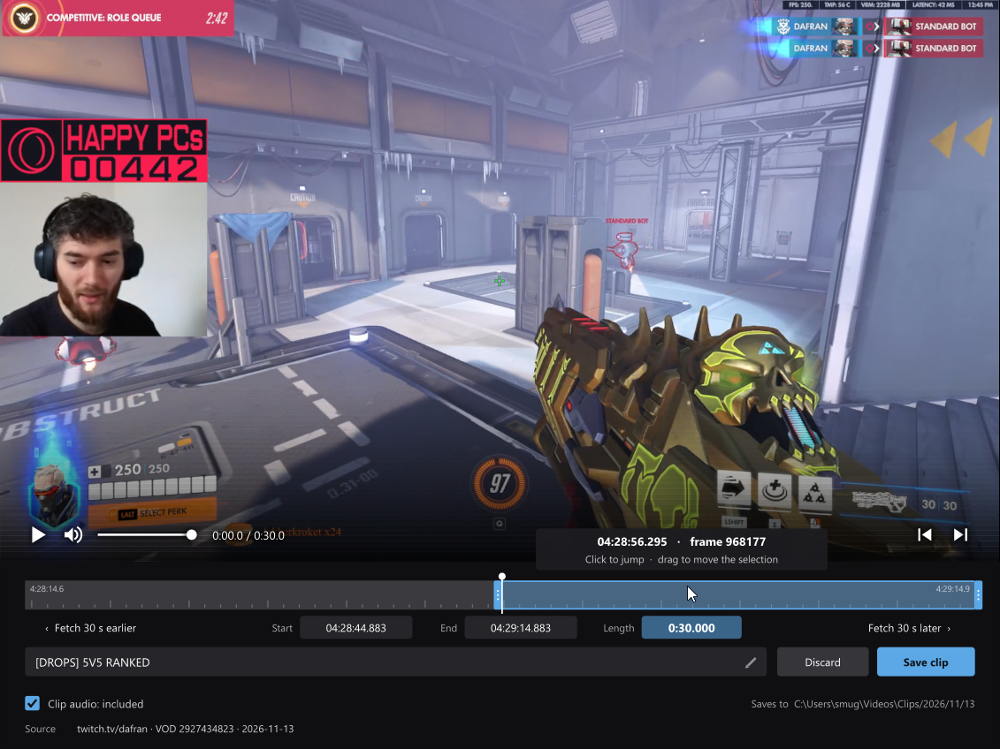

# clipper

Press **Ctrl+G** in mpv to open a clip editor in a second window: a trim bar, frame-accurate start/end fields and a Save button. The main player keeps its position. Works for local files, live streams and Twitch VODs; saves H.264/AAC MP4s.

## Install

Copy `scripts/clipper` into `%APPDATA%\mpv\scripts\` (or run `py tools/install.py` from the repo root). Needs Python 3.10+ and FFmpeg (libx264, AAC; `ffprobe` too for streams) on PATH. On Windows the `py` launcher is used. Options go in `script-opts/clipper.conf` (sample included).

If modernz or ModernX is installed, clipper adds a scissors button to it on first start (left click: editor, right click: live-cache mode). The [ModernZ fork](../ModernZ) already has it. Remap the key with `c script-binding clipper/open` in `input.conf`.

## Editing

| Control | Action |
|---|---|
| Drag a blue handle | Move the in / out point |
| Click / drag inside the selection | Jump the playhead / move the whole selection |
| Click or drag outside it | Scrub without moving the selection |
| Scroll / Shift+scroll on the bar | Zoom / pan the timeline |
| Space, click the video | Play or pause the selection on a loop |
| `[` / `]` | Set in / out at the playhead |
| Left / Right, `,` / `.` | Step one frame |
| Click Start, End or Length | Focus, then Left/Right = 0.1 s, Up/Down = 1 s, `,` `.` = one frame |
| Double-click Start, End or Length | Type a value (`12.5`, `1:23`, `0:01:23.4`) |
| Click the title | Edit the output name |
| `M` or the audio checkbox | Include or remove the audio |
| Enter / Save clip | Export; Esc / Discard closes the editor |

Local files open with the whole video on the bar. Streams open with the last `seconds` selected and `backread` seconds loaded in total; the buttons at either end of the bar load another `seconds` of earlier or later footage. Saved files go to `output/YYYY/MM/DD/title_HH-MM-SS.mmm.mp4`; the source (path, URL, or channel and VOD) is stored in the file's `comment` tag.

## Options

| Option | Default | Effect |
|---|---|---|
| `output` | `~/Videos/Clips` | Output folder |
| `seconds` | `30` | Initial selection and fetch step |
| `backread` | `60` | Footage loaded when the editor opens |
| `history` | `300` | Seconds of stream cache the tips below aim for |
| `python`, `mpv`, `ffmpeg` | `python` (`python3` on Linux), beside mpv, `ffmpeg` | Executables; on Windows `py` also works; give a full path if not on PATH |
| `pause_on_clip` | `yes` | Pause the main player on Clip |
| `match_titlebar` | `yes` | Editor copies the player's `border` / `title-bar` |
| `osc_button` | `yes` | Add the button to modernz / ModernX |
| `stream_tips` | `yes` | Offer a bigger back buffer when a stream's cache is too small for `history` |
| `stream_back_bytes` | empty | Back buffer applied to streams (set by the tip's **Apply**) |

## Streams

- **Open in mpv:** Ctrl+G dumps the player's cache. Only what is cached is available, so a big back buffer (see `stream_tips`) helps. Bind `script-binding clipper/open-live` to force this mode.
- **Twitch:** with [twitch-rewind](../twitch-rewind/README.md), the footage is cut from the broadcast's VOD (`ffmpeg -c copy`, only the needed segments are downloaded), so the length does not depend on the cache. While live, footage older than the cache is cut from the VOD and joined to the cached part. The VOD must contain it; the newest few seconds may not be there yet.
- **Rolling recorder:** for an uninterrupted live source, `py scripts/clipper/live.py --name Channel --history 300 <direct stream URL>` plays it in mpv while keeping recent history on disk, so Ctrl+G always has it.

Exports re-encode (libx264, CRF 18, veryfast), so cuts need not land on keyframes. A failed export keeps the selection for another try.
